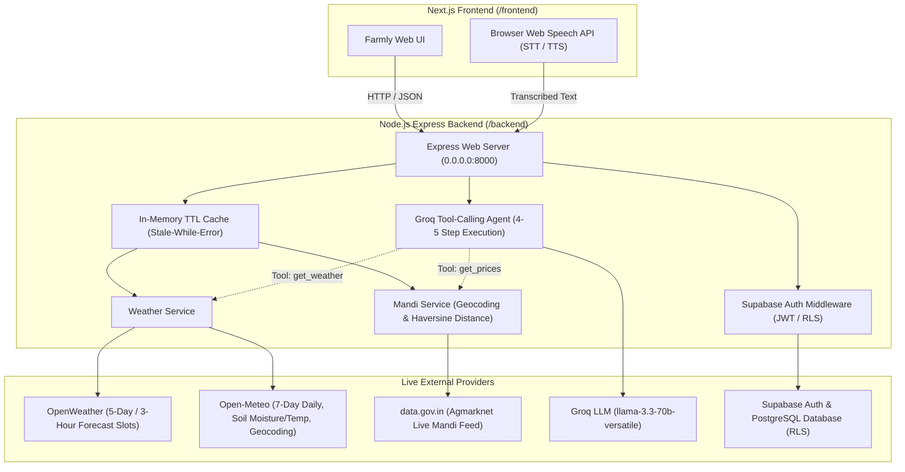

# Farmly.AI — Live Advisory Backend for Indian Farmers

Farmly.AI is an agricultural advisory platform built for Indian farmers. It provides real-time weather alerts, Agmarknet mandi market intelligence with geocoded travel distances, and an autonomous Gen AI advisor powered by Groq and tool calling.

---

## 1. System Architecture



---

## 2. Local Setup & Running (Windows PowerShell)

### Prerequisites
* **Node.js 20+** (Tested on Node.js v24.12.0)
* Environment variables in `.env` in the repository root.

### Step 1: Install Backend Dependencies
```powershell
npm install --prefix backend
```

### Step 2: Configure Environment Variables
Copy `.env.example` to `.env` (or verify that `.env` exists in the repo root):
```powershell
Copy-Item .env.example .env
```
Ensure the following variable names are configured:
* `PORT=8000`
* `FRONTEND_ORIGIN=http://localhost:3000`
* `OPENWEATHER_API_KEY=your_openweather_key`
* `DATA_GOV_API_KEY=your_datagovin_key`
* `GROQ_API_KEY=your_groq_key`
* `GROQ_MODEL=llama-3.3-70b-versatile`
* `SUPABASE_URL=https://your-project.supabase.co`
* `SUPABASE_ANON_KEY=your_supabase_anon_key`
* `SUPABASE_SERVICE_ROLE_KEY=your_supabase_service_role_key`
* `SUPABASE_JWT_SECRET=your_supabase_jwt_secret`

### Step 3: Start the Backend Server
* **Development mode with auto-reload**:
  ```powershell
  Set-Location backend
  npm run dev
  ```
* **Production mode**:
  ```powershell
  Set-Location backend
  npm start
  ```
The server will start and bind to `http://0.0.0.0:8000`.

### Step 4: Run the Live Comprehensive Smoke Test
Verify all endpoints against live external services:
```powershell
Set-Location backend
npm run smoke
```

---

## 3. Render Deployment Guide

Deploy the backend as a **Web Service** on [Render](https://render.com):

1. **New Web Service**: Connect your repository.
2. **Settings**:
   * **Name**: `farmly-backend`
   * **Region**: `Singapore` (Lowest latency for Indian APIs and users)
   * **Runtime**: `Node`
   * **Root Directory**: `backend`
   * **Build Command**: `npm install`
   * **Start Command**: `node src/server.js`
   * **Health Check Path**: `/` (Fast lightweight check for cold starts)
3. **Environment Variables on Render**:
   Add the following in the Render Dashboard (**Environment > Add Environment Variable**):
   * `PORT`: `8000` (or leave default `$PORT`)
   * `FRONTEND_ORIGIN`: Your production Vercel frontend URL (e.g. `https://farmly-app.vercel.app,http://localhost:3000`)
   * `OPENWEATHER_API_KEY`: Your OpenWeather API key
   * `DATA_GOV_API_KEY`: Your data.gov.in Agmarknet API key
   * `GROQ_API_KEY`: Your Groq Cloud API key
   * `GROQ_MODEL`: `llama-3.3-70b-versatile`
   * `SUPABASE_URL`: Your Supabase Project URL
   * `SUPABASE_ANON_KEY`: Your Supabase Public Anon Key
   * `SUPABASE_SERVICE_ROLE_KEY`: Your Supabase Service Role Key (Keep server-only!)
   * `SUPABASE_JWT_SECRET`: Your Supabase JWT Secret

---

## 4. Supabase Database Migration

To set up the Supabase database and enable Row Level Security (RLS):
1. Open your Supabase Dashboard and go to **SQL Editor > New Query**.
2. Run the SQL script located at [`backend/supabase_schema.sql`](backend/supabase_schema.sql).
3. Under **Authentication > Providers > Email**, turn **OFF** "Confirm email" so farmers can register and immediately log in.

---

## 5. Legacy Files to Remove

As instructed during the backend migration from Python to Node.js, the following legacy Python files have been preserved in the root directory for you to safely remove when ready:
* `main.py` (legacy FastAPI entry point)
* `requirements.txt` (legacy Python packages list)
* `venv/` (legacy Python virtual environment)

All active backend logic lives strictly inside `/backend`.
