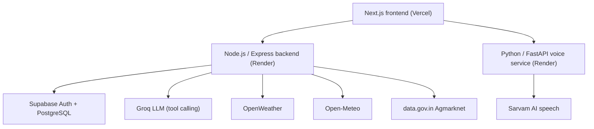

# Farmly.AI

An AI advisory app for Indian farmers. It combines live weather, live mandi (market) prices and a tool-using AI advisor, with voice input and output in Telugu, Hindi and English.

**Live app:** https://YOUR-APP.vercel.app (the first request can take up to a minute while the free servers wake up)

## What it does

- **Weather:** live 5-day forecast and 7-day outlook for any district, with rain alerts computed from the live numbers (the threshold and observed value are shown).
- **Soil conditions:** live soil moisture and soil temperature from Open-Meteo.
- **Mandi prices:** live Agmarknet prices from data.gov.in, with distances computed by geocoding the market names, and an estimated net return per quintal. The transport rate is a labelled assumption, not an official figure.
- **AI advisor:** a Groq-powered agent that calls the weather, soil and mandi tools, answers only from what they return, and cites its sources. If a source is down, it says so instead of guessing.
- **Voice:** speech-to-text and text-to-speech through Sarvam AI (Telugu, Hindi, English).
- **Accounts:** Supabase Auth with email and password, and Row Level Security so each farmer only sees their own profile.
- **Schemes:** a reference directory with links to official portals. It is a static list, not live data and not personalised eligibility.

## Architecture



| Folder | What it is |
|---|---|
| `frontend/` | Next.js app (pnpm) |
| `backend/` | Express API: weather, mandi, advisor, auth and profile |
| `voice-service/` | FastAPI service for speech-to-text and text-to-speech |

## Data sources

All results come from live APIs at request time (cached for a few minutes). Nothing is mocked.
OpenWeather, Open-Meteo, data.gov.in (Agmarknet), Groq, Sarvam AI and Supabase.

## Run it locally

Requirements: Node.js 20+, pnpm, Python 3.12.

**1. Backend (port 8000)**
```powershell
cd backend
npm install
Copy-Item .env.example .env   # then fill in the values
npm run dev
```

**2. Voice service (port 8001)**
```powershell
cd voice-service
python -m venv venv
.\venv\Scripts\Activate.ps1
pip install -r requirements.txt
# create voice-service/.env with SARVAM_API_KEY
uvicorn main:app --port 8001 --reload
```

**3. Frontend (port 3000)**
```powershell
cd frontend
pnpm install
# create frontend/.env.local with:
#   NEXT_PUBLIC_API_URL=http://127.0.0.1:8000
#   NEXT_PUBLIC_VOICE_API_URL=http://127.0.0.1:8001
pnpm dev
```

## Environment variables (names only)

| Service | Variables |
|---|---|
| Backend | `FRONTEND_ORIGIN`, `OPENWEATHER_API_KEY`, `DATA_GOV_API_KEY`, `GROQ_API_KEY`, `GROQ_MODEL`, `SUPABASE_URL`, `SUPABASE_ANON_KEY`, `SUPABASE_SERVICE_ROLE_KEY`, `SUPABASE_JWT_SECRET` |
| Voice service | `SARVAM_API_KEY`, `FRONTEND_ORIGIN` |
| Frontend | `NEXT_PUBLIC_API_URL`, `NEXT_PUBLIC_VOICE_API_URL` |

`GROQ_MODEL` is the Groq model your key can use (for example `openai/gpt-oss-120b`). Check Groq's model list, because names change. Never commit real keys.

## Deploy

- **Backend (Render Web Service):** Root Directory `backend`, Build `npm install`, Start `npm start`, region Singapore. Add the backend variables, plus `NODE_VERSION=20`. Do not set `PORT`.
- **Voice service (Render Web Service):** Root Directory `voice-service`, Build `pip install -r requirements.txt`, Start `uvicorn main:app --host 0.0.0.0 --port $PORT`. Add `SARVAM_API_KEY` and `PYTHON_VERSION=3.12.3`.
- **Frontend (Vercel):** Root Directory `frontend`. Set `NEXT_PUBLIC_API_URL` and `NEXT_PUBLIC_VOICE_API_URL` to the two Render URLs, then redeploy.
- **CORS:** set `FRONTEND_ORIGIN` on both Render services to your Vercel URL (comma-separated if you also want `http://localhost:3000`).
- **Database:** run `backend/supabase_schema.sql` in the Supabase SQL editor, and turn off "Confirm email" under Authentication, Providers, Email.

## Known limits

- Mandi data comes from a government API that can be slow or incomplete. Some crops and districts have no reported prices on a given day, and the app says so.
- Price trends need several dates of data. When the feed returns only one date, the app reports "insufficient data".
- The transport cost used for net-return estimates is an adjustable assumption.
- Voice supports Telugu, Hindi and English only.
- The schemes screen is a static directory with official links.
- Free hosting sleeps when idle, so the first request after a pause is slow.

## License

Add a license of your choice.