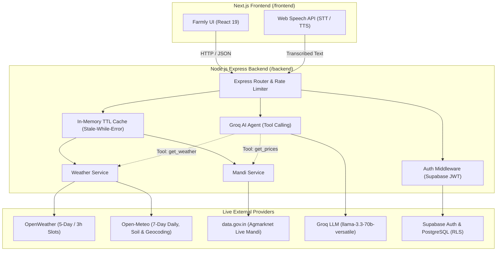

# Farmly.AI Backend API Specification & Integration Contract

This document is the contract for connecting the Next.js frontend to the live Node.js Express backend (`/backend`).

---

## 1. Upstream Services & System Architecture



---

## 2. API Endpoints

### 2.1 System & Health

#### `GET /`
Lightweight health check for Render cold starts and load balancers.
* **Auth**: None
* **Response (200 OK)**:
```json
{
  "status": "ok",
  "app": "Farmly.AI Backend",
  "version": "1.0.0",
  "timestamp": "2026-10-31T13:17:59.690Z"
}
```

#### `GET /api/status`
Real-time diagnostic endpoint reporting latency, upstream reachability, and configuration status for all external APIs.
* **Auth**: None
* **Response (200 OK)**:
```json
{
  "status": "operational",
  "app": "Farmly.AI Backend",
  "timestamp": "2026-10-31T13:18:00.916Z",
  "services": {
    "openweather": {
      "configured": true,
      "status": "operational",
      "latency_ms": 307,
      "last_check": "2026-10-31T13:18:00.916Z"
    },
    "open_meteo": {
      "configured": true,
      "status": "operational",
      "latency_ms": 284,
      "last_check": "2026-10-31T13:18:00.916Z"
    },
    "data_gov_in_agmarknet": {
      "configured": true,
      "status": "operational",
      "latency_ms": 1152,
      "last_check": "2026-10-31T13:18:00.916Z"
    },
    "groq_ai": {
      "configured": true,
      "status": "operational",
      "model_configured": "llama-3.3-70b-versatile",
      "latency_ms": 298,
      "last_check": "2026-10-31T13:18:00.916Z"
    },
    "supabase": {
      "configured": false,
      "status": "not_configured",
      "message": "SUPABASE_URL and SUPABASE_ANON_KEY need to be set in .env",
      "last_check": "2026-10-31T13:18:00.916Z"
    }
  }
}
```

---

### 2.1b Locations (States & Districts)

#### `GET /api/locations/states`
Indian states and union territories for the Profile and Onboarding pickers.
* **Auth**: None
* **Live order**: (1) official LGD States resource `a71e60f0-a21d-43de-a6c5-fa5d21600cdb` on data.gov.in, (2) distinct states from Agmarknet resource `9ef84268-d588-465a-a308-a864a43d0070` only when that feed looks complete, (3) bundled LGD snapshot dated 2026-10-31.
* **Cache**: 24 hours, stale-while-error.

#### `GET /api/locations/districts?state=<name>`
Districts for one canonical state.
* **Auth**: None
* **Live order**: (1) official LGD Districts resource `37231365-78ba-44d5-ac22-3deec40b9197` filtered by `state_name_english`, (2) Agmarknet daily feed, (3) bundled LGD snapshot dated 2026-10-31.
* **Query**: `state` (required). 422 if missing, 404 if not a known Indian state.
* **Errors**: `{ detail, source, retryable }`

---

### 2.2 Weather & Soil Intelligence

#### `GET /api/weather`
Current conditions, 5-day / 3-hour forecast with probability of precipitation (`pop`) per slot, 7-day daily forecast, and agricultural alerts derived strictly from live values.
* **Auth**: None (Public)
* **Query Parameters**:
  * `city` (string, optional): City or district in India (e.g. `Ranchi`, `Khunti`)
  * `lat` (number, optional): Latitude (-90 to 90)
  * `lon` (number, optional): Longitude (-180 to 180)
* **Real Live Response (200 OK)**:
```json
{
  "location": {
    "name": "Ranchi",
    "state": "Jharkhand",
    "lat": 23.3432,
    "lon": 85.3094
  },
  "current": {
    "temp_c": 23.3,
    "feels_like_c": 24,
    "humidity": 86,
    "rain_chance": 100,
    "wind_kmh": 9,
    "description": "light rain",
    "icon": "10d",
    "soil_moisture_pct": 40,
    "soil_temperature_c": 21.3
  },
  "daily_7day": [
    {
      "date": "2026-10-31",
      "day": "Sat",
      "temp_max_c": 26,
      "temp_min_c": 20,
      "pop_max": 100,
      "rain_mm": 1.7,
      "weather_code": 80,
      "label": "Rain showers"
    },
    {
      "date": "2026-11-01",
      "day": "Sun",
      "temp_max_c": 27,
      "temp_min_c": 19,
      "pop_max": 33,
      "rain_mm": 0.4,
      "weather_code": 2,
      "label": "Partly cloudy"
    }
  ],
  "forecast_5day": [
    {
      "time": "2026-10-31 15:00:00",
      "timestamp": 1793449200,
      "temp_c": 23.3,
      "feels_like_c": 24,
      "temp_min_c": 23.3,
      "temp_max_c": 23.3,
      "humidity": 86,
      "pop": 100,
      "rain_mm": 1.3,
      "wind_kmh": 9,
      "description": "light rain",
      "icon": "10d"
    }
  ],
  "alerts": [
    {
      "type": "heavy_rain",
      "severity": "action_needed",
      "title": "Rainfall Advisory",
      "message": "Showers expected in the next 36 hours. Clear field drainage channels and postpone fertilizer or chemical spray.",
      "condition": "rain_probability >= 60% or rain_accumulation >= 15mm in 36h",
      "threshold": 60,
      "observed_value": 100,
      "observed_accumulation_mm": 1.7,
      "unit": "%",
      "window_hours": 36
    }
  ],
  "soil": {
    "soil_temperature_c": 21.3,
    "soil_moisture_pct": 40,
    "soil_moisture_volumetric_m3m3": 0.392,
    "source": "Open-Meteo"
  },
  "source": "Slots: OpenWeather | Daily & Soil: Open-Meteo",
  "slot_source": "OpenWeather",
  "daily_source": "Open-Meteo",
  "soil_source": "Open-Meteo",
  "fetched_at": "2026-10-31T13:03:31.916Z",
  "stale": false
}
```

#### `GET /api/weather/soil`
Live physical soil moisture and soil temperature from Open-Meteo.
* **Auth**: None
* **Query Parameters**: `city` (string) OR `lat` and `lon` (numbers)
* **Real Live Response (200 OK)**:
```json
{
  "location": {
    "name": "Khunti",
    "lat": 23.076,
    "lon": 85.2782
  },
  "soil_moisture_pct": 41,
  "soil_moisture_volumetric_m3m3": 0.41,
  "soil_temperature_c": 21,
  "source": "Open-Meteo (live keyless API)",
  "fetched_at": "2026-10-31T13:03:32.727Z",
  "stale": false
}
```

---

### 2.3 Mandi Prices Intelligence

#### `GET /api/prices`
Real live Agmarknet mandi prices from data.gov.in with live geocoded market distances, user-specified transport deductions, and statistical summaries.
* **Auth**: None (Public)
* **Query Parameters**:
  * `commodity` (string, optional): e.g. `Maize`, `Paddy`, `Tomato`
  * `state` (string, optional): e.g. `Jharkhand`, `Rajasthan`
  * `district` (string, optional): e.g. `Khunti`
  * `user_lat` (number, optional): Farmer's latitude
  * `user_lon` (number, optional): Farmer's longitude
  * `transport_rate_per_km` (number, optional): User-defined transport rate in ₹/km/quintal (e.g. `8`)
  * `quantity` (number, optional, default `1`): Harvest quantity in quintals
  * `limit` (number, optional, default `50`, max `100`)
* **Real Live Response (200 OK)**:
```json
{
  "source": "data.gov.in Agmarknet Daily Feed (Resource 9ef84268-d588-465a-a308-a864a43d0070)",
  "resource_id": "9ef84268-d588-465a-a308-a864a43d0070",
  "filters": {
    "state": "Andhra Pradesh",
    "commodity": "Paddy(Common)",
    "district": null,
    "market": null
  },
  "summary": {
    "total_records": 5,
    "min_modal_price": 2850,
    "max_modal_price": 3600,
    "avg_modal_price": 3220,
    "date_range": {
      "earliest": "31/10/2026",
      "latest": "31/10/2026",
      "unique_dates": ["31/10/2026"]
    }
  },
  "transport_rate_applied": 8,
  "transport_notice": "Transport cost calculated at ₹8/km/quintal over live geocoded distance.",
  "recommendation": {
    "market": "Parchur APMC",
    "district": "Prakasam",
    "state": "Andhra Pradesh",
    "modal_price": 3600,
    "distance_km": 880.5,
    "estimated_net_per_q": -3444,
    "estimated_total_return": -86100,
    "basis": "Highest estimated net return after user-specified transport cost"
  },
  "records": [
    {
      "state": "Andhra Pradesh",
      "district": "Prakasam",
      "market": "Parchur APMC",
      "commodity": "Paddy(Common)",
      "variety": "B P T",
      "grade": "FAQ",
      "arrival_date": "31/10/2026",
      "min_price": 3500,
      "max_price": 3700,
      "modal_price": 3600,
      "coordinates": { "lat": 15.961, "lon": 80.264 },
      "distance_km": 880.5,
      "transport_rate_per_km": 8,
      "transport_cost_per_q": 7044,
      "estimated_net_per_q": -3444,
      "estimated_total_return": -86100
    }
  ],
  "fetched_at": "2026-10-31T13:08:50.422Z",
  "stale": false
}
```

#### `GET /api/prices/trend`
Real price trend computed strictly from distinct arrival dates. If single-date reporting, honestly returns `insufficient_data: true`.
* **Auth**: None
* **Query Parameters**: `commodity` (required), `state` (optional), `district` (optional)
* **Real Live Response (200 OK - Single Date Feed)**:
```json
{
  "insufficient_data": true,
  "message": "Insufficient historical arrival dates returned from live mandi feed to compute a valid price trend. Live feed contains single-date reporting.",
  "commodity": "Maize",
  "state": "All",
  "available_dates": ["31/10/2026"],
  "sample_records_count": 10,
  "source": "data.gov.in Agmarknet Daily Feed (Resource 9ef84268-d588-465a-a308-a864a43d0070)",
  "fetched_at": "2026-10-31T13:08:50.422Z"
}
```

---

### 2.4 AI Advisor Agent (`POST /api/advice`)

Tool-calling agent backed by Groq LLM with live invocation of weather, mandi prices, trends, and soil moisture.
* **Auth**: Optional (Public with rate limiter: 30 requests / 15 min per IP)
* **Request Body**:
```json
{
  "question": "Will it rain in Khunti in the next 36 hours and should I apply fertilizer to my paddy?",
  "crop": "Paddy",
  "city": "Khunti",
  "district": "Khunti",
  "state": "Jharkhand",
  "language": "English"
}
```
* **Real Live Response (200 OK)**:
```json
{
  "answer": "**Weather outlook for Khunti (next 36 hours)**\n- Current condition: Light rain, temperature 23.4 °C, humidity 84 %, rain-chance 88 % (OpenWeather/Open-Meteo).\n- Forecast slots show an 88% chance of rain at 15:00 today (0.49 mm), followed by showers at 06:00 (20%) and 09:00 (59%).\n- Rainfall Advisory: Showers expected in the next 36 hours. Clear field drainage channels and postpone fertilizer or chemical spray.\n\n**Agronomic Advice:**\n- Postpone any fertilizer or pesticide spray until rain subsides and canopy dries. Wet foliage washes chemicals into runoff.\n- Current volumetric soil moisture is 41%, which is adequate for paddy flowering stage.",
  "steps": [
    {
      "tool": "get_weather",
      "args": { "city": "Khunti" },
      "ok": true,
      "latency_ms": 2078
    }
  ],
  "sources": [
    {
      "source": "Slots: OpenWeather | Daily & Soil: Open-Meteo",
      "fetched_at": "2026-10-31T13:03:31.916Z"
    }
  ],
  "warnings": []
}
```

---

### 2.5 Auth & Farmer Profile (Supabase)

#### `POST /api/auth/signup`
Creates a new farmer account using Supabase Auth (Email + Password).
* **Request Body**:
```json
{
  "email": "farmer.ramesh@example.com",
  "password": "StrongPassword123!",
  "name": "Ramesh Kumar",
  "language": "Hindi",
  "mobile": "9876543210"
}
```
* **Response (201 Created)**:
```json
{
  "message": "Farmer account created successfully.",
  "access_token": "eyJhbGciOi...",
  "refresh_token": "...",
  "token_type": "Bearer",
  "user": {
    "id": "123e4567-e89b-12d3-a456-426614174000",
    "email": "farmer.ramesh@example.com",
    "name": "Ramesh Kumar",
    "language": "Hindi"
  },
  "profile": {
    "id": "123e4567-e89b-12d3-a456-426614174000",
    "name": "Ramesh Kumar",
    "language": "Hindi"
  }
}
```

#### `POST /api/auth/login`
Authenticates with email and password.
* **Request Body**:
```json
{
  "email": "farmer.ramesh@example.com",
  "password": "StrongPassword123!"
}
```
* **Response (200 OK)**: Returns `{ access_token, refresh_token, token_type: "Bearer", user, profile }`.

#### `GET /api/profile`
Retrieves authenticated farmer profile from Supabase `public.profiles`.
* **Auth Required**: `Authorization: Bearer <access_token>`
* **Response (200 OK)**:
```json
{
  "id": "123e4567-e89b-12d3-a456-426614174000",
  "name": "Ramesh Kumar",
  "email": "farmer.ramesh@example.com",
  "mobile": "9876543210",
  "language": "Hindi",
  "state": "Jharkhand",
  "district": "Khunti",
  "village": "Jilingsereng",
  "acres": 2.5,
  "land_status": "Owner",
  "crops": ["Paddy", "Maize"],
  "soil": "Clay loam",
  "irrigation": "Rain-fed",
  "experience": "12 years",
  "preferences": {
    "interaction": "voice",
    "weatherAlerts": true,
    "schemeUpdates": true,
    "cropAlerts": true
  }
}
```

#### `PUT /api/profile`
Updates farmer profile with RLS protection.
* **Auth Required**: `Authorization: Bearer <access_token>`
* **Request Body**: Partial or full fields from profile schema.

---

## 3. Frontend Changes Needed

### 3.1 Screens to Hide / Remove Mock Fixtures (Strict Hackathon Rules)
As per hackathon rules (no fake/static placeholder fixtures) and Scope Item 7:
1. **Schemes & Support (`SchemesScreen` in `screens.tsx`)**:
   * *Status*: **HIDE FROM NAVIGATION**.
   * *Reason*: India has no open public API for real-time government scheme applications or live individual eligibility verification. The 6 hardcoded schemes (`PM-KISAN`, `PMFBY`, `KCC`, etc.) in `screens.tsx` must be hidden rather than displayed as dynamic live data.
2. **Crop Planner (`CropPlannerScreen` in `screens.tsx`)**:
   * *Status*: **HIDE FROM NAVIGATION** or redirect prompt to **Voice Assistant**.
   * *Reason*: The static 6-step plan and hardcoded cost dictionary (`Paddy: 9000`, `Maize: 7600`) are static fixtures. Farm planning is dynamically handled through `POST /api/advice` via the AI Advisor.
3. **Soil Health Chemistry (`SoilScreen` in `screens.tsx`)**:
   * *Status*: **HIDE MOCK NPK & pH BARS**.
   * *Reason*: Soil chemistry (Nitrogen, Phosphorus, Potassium, pH) requires physical laboratory soil testing. Only **live soil moisture and soil temperature** (from `GET /api/weather/soil`) are backed by a real live source (Open-Meteo) and may be displayed.

### 3.2 Screen-to-Endpoint Integration Map

| Screen | File Location | Existing Mock Data to Remove | Live Backend Endpoint to Connect |
| :--- | :--- | :--- | :--- |
| **Auth (Login / Signup)** | `components/farmly/auth-experience.tsx` | Simulated 360ms timer, mock OTP `123456`, `sessionStorage` | Replace simulated submit with `POST /api/auth/signup` and `POST /api/auth/login`. Store the returned `access_token` in `localStorage`. |
| **Dashboard / Overview** | `components/farmly/overview.tsx` | Static `forecast` array (Mon-Sun rain %), static metrics (29°C, 75%, 42%), static mandi preview (Ranchi ₹2350, Khunti ₹2280) | Call `GET /api/weather?city={profile.district}`: feed `daily_7day` into the area chart, `current` into metric cards, and `alerts` into the rain advisory card. Call `GET /api/prices?state={profile.state}&commodity={profile.crop}` for mandi preview. |
| **Weather Screen** | `components/farmly/screens.tsx` | Static `weatherRows` array (Oct 30 - Nov 5), static humidity (78%), static wind (12 km/h) | Call `GET /api/weather?city={profile.district}`: map `forecast_5day` to 3-hour slots and `daily_7day` to the 7-day view. Bind `alerts` to the crop risk box. |
| **Mandi Screen** | `components/farmly/screens.tsx` | Static `markets` array (Ranchi APMC, Khunti, Ramgarh), hardcoded ₹9/km transport cost, static price adjustments (`Maize: -450`) | Call `GET /api/prices?commodity={crop}&state={state}&transport_rate_per_km={rate}`: render `records` table, statistical `summary`, and `recommendation`. Call `GET /api/prices/trend` for price movements. |
| **Voice Screen** | `components/farmly/screens.tsx` | Static regex lookup table `voiceResponses` (English, Hindi, Telugu) | Pass transcribed text from browser `SpeechRecognition` to `POST /api/advice`. Read response aloud via `speechSynthesis`. |
| **Profile Screen** | `components/farmly/screens.tsx` & `farmly-app.tsx` | `localStorage` only (`farmly-profile`) | Call `GET /api/profile` on mount with `Bearer <token>`; call `PUT /api/profile` on save. |

### 3.3 Browser Web Speech API Integration (Zero Paid Speech APIs)
The voice assistant in `components/farmly/screens.tsx` uses native browser APIs:
```javascript
// Speech-to-Text (Browser Native)
const recognition = new (window.SpeechRecognition || window.webkitSpeechRecognition)();
recognition.lang = language === "हिंदी" ? "hi-IN" : language === "తెలుగు" ? "te-IN" : "en-IN";
recognition.onresult = async (event) => {
  const query = event.results[0][0].transcript;
  // Send query directly to Farmly AI Backend
  const res = await fetch("http://localhost:8000/api/advice", {
    method: "POST",
    headers: { "Content-Type": "application/json" },
    body: JSON.stringify({ question: query, language, crop: profile.crop, city: profile.district })
  });
  const data = await res.json();
  // Text-to-Speech (Browser Native)
  const utterance = new SpeechSynthesisUtterance(data.answer);
  utterance.lang = recognition.lang;
  window.speechSynthesis.speak(utterance);
};
```

---

## 4. Supabase Setup Guide

Follow these steps to connect your live Supabase project:

1. **Create Supabase Project**: Go to [supabase.com](https://supabase.com), create a new project (e.g. `farmly-production`).
2. **Retrieve Credentials**:
   * Project Settings > API:
     * **Project URL**: Add as `SUPABASE_URL` in `.env`
     * **anon / public key**: Add as `SUPABASE_ANON_KEY` in `.env`
     * **service_role key**: Add as `SUPABASE_SERVICE_ROLE_KEY` in `.env` (Server only! Never expose to client).
   * Project Settings > API > JWT Settings:
     * **JWT Secret**: Add as `SUPABASE_JWT_SECRET` in `.env`
3. **Turn OFF Email Confirmation**:
   * In Supabase Dashboard: **Authentication > Providers > Email**.
   * Toggle **OFF** "Confirm email". (Farmers can now sign up and immediately log in).
4. **Execute Database Migration**:
   * In Supabase Dashboard: **SQL Editor > New Query**.
   * Copy and paste the complete contents of [`backend/supabase_schema.sql`](file:///C:/Users/PRAVEEN%20KUMAR/forge-app/backend/supabase_schema.sql).
   * Click **Run**. This establishes `profiles`, `advice_history`, all RLS policies, and the `on_auth_user_created` trigger.
